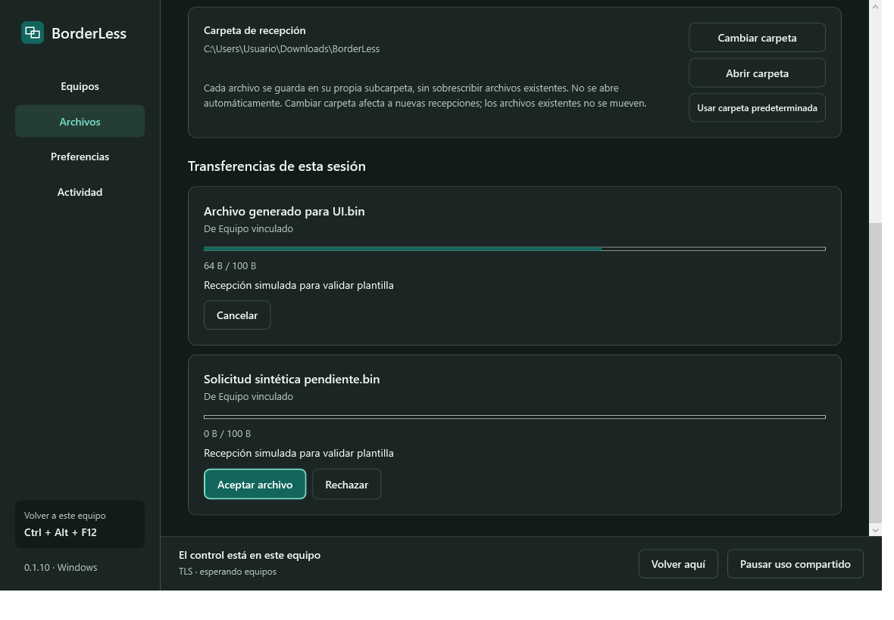
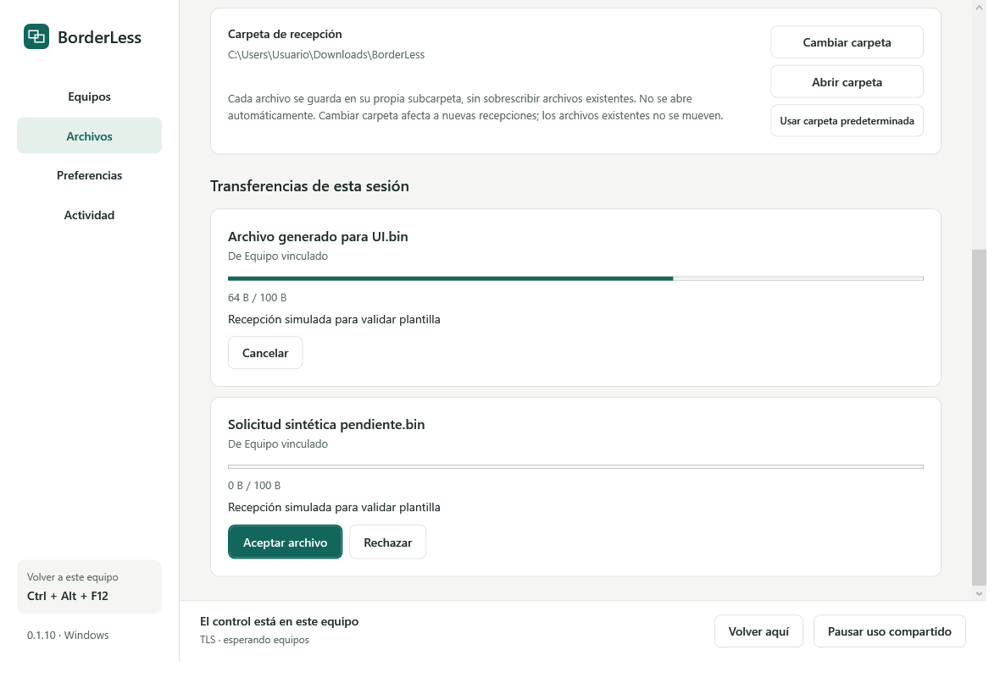

# BorderLess

Un mouse y un teclado para tus PCs Windows 11. Controla otro equipo al cruzar el borde de la pantalla y comparte texto, imágenes y archivos mediante conexiones cifradas. No transmite la pantalla.

**Versión 0.1.10 · Windows 11 x64 · Español / English**

[Descargas y versiones](https://github.com/edwincsabo/BorderLess/releases) · [Instalación](INSTALAR.md) · [Guía de uso](COMO_USAR.md) · [Actualizar portable](ACTUALIZAR.md) · [Licencia](LICENSE)

## Funciones

- Mouse y teclado entre equipos, acceso por los cuatro bordes y recuperación con **Ctrl + Alt + F12**.
- PIN de ocho dígitos, detección local y reconexión con credenciales guardadas.
- Canales TLS separados para entrada, portapapeles y archivos.
- Portapapeles de texto e imágenes; archivos opcionales con aceptación individual.
- Alias, mapa de PCs y monitores y carpeta de recepción configurable.
- Temas claro y oscuro, español e inglés, bandeja de Windows.
- Conexión directa por LAN/VPN y relay propio opcional para internet.

## Capturas

Interfaz real renderizada con datos de prueba y rutas ficticias.

### Modo oscuro



### Modo claro



## Empezar

1. Descarga **setup-win-x64.exe** de [Releases](https://github.com/edwincsabo/BorderLess/releases). Incluye .NET. También hay portable completo y actualización pequeña para portables existentes.
2. Si ya usas el portable, sal mediante **Salir** e importa la carpeta **data de ese mismo PC y usuario** en el asistente. No copies perfiles entre PCs.
3. En un equipo: **Añadir equipo → Recibir en este PC → Generar código de 8 dígitos**.
4. En el otro: **Conectar a otro PC → Buscar equipos**, escribe el PIN y vincula. El PIN correcto vincula sin segunda confirmación.
5. Asigna un borde o pulsa **Controlar**. Para recuperar el control local usa **Ctrl + Alt + F12**.

Desactiva Mouse sin bordes de PowerToys si lo utilizas para evitar captura simultánea. Puerto habitual TCP 45161; búsqueda UDP 45163. La app no configura el firewall automáticamente.

La X mantiene el programa en la bandeja; **Salir** lo termina. **Volver aquí** recupera el control local; **Pausar uso compartido** suspende entrada, portapapeles y archivos sin borrar vínculos.

## Límites

Archivos viene desactivado y requiere activación en ambos extremos y aceptación por archivo. Un archivo por vez, hasta 1 GiB, aproximadamente 1 MiB/s. No incluye carpetas, arrastre ni reanudación. Cambiar la carpeta afecta a nuevas recepciones y no mueve archivos anteriores.

No controla UAC ni la pantalla bloqueada. Las aplicaciones elevadas pueden necesitar BorderLess con permisos equivalentes en el receptor. Los ejecutables no tienen firma de código y están sujetos a las políticas del equipo. No existe un relay público del proyecto.

La respuesta depende de red, Windows y carga de los equipos. No se garantiza latencia cero ni una ventaja medida frente a PowerToys. [Validación local y alcance](docs/VALIDACION.md).

## Compilar

Requisitos: Windows 11 x64 y SDK .NET 10 (validado con 10.0.403). BouncyCastle está fijado en el proyecto y su lockfile. En una copia pública se descarga desde NuGet.org; un paquete local en vendor/packages permite compilar sin red.

```powershell
.\scripts\Build.ps1
.\scripts\Test.ps1
.\scripts\Build.ps1 -Portable
.\scripts\Prepare-InstallerCompiler.ps1
.\scripts\Build-Installer.ps1 -SkipPortableBuild
```

La preparación del compilador verifica hash y firma del Inno Setup 7.1.1 oficial. Los paquetes incluyen runtime y avisos de licencia, excluyendo perfiles. GitHub Actions compila y publica una release cuando la versión del proyecto todavía no existe.

## Estructura

- src/BorderLess.App: WPF, integración Windows, interfaz y preferencias.
- src/BorderLess.Core: protocolo, TLS, PIN, colas y archivos.
- src/BorderLess.Relay: relay TCP para despliegue propio.
- tests: protocolo, Windows, UI y mediciones.
- installer y scripts: compilación, paquetes e instalador.

## Licencia

Copyright 2026 Edwin Sabogal. [PolyForm Noncommercial 1.0.0](LICENSE): permite usar, modificar y redistribuir para fines no comerciales, sujeto a sus términos. Esta restricción implica que no es una licencia de código abierto aprobada por la OSI. [Texto oficial](https://polyformproject.org/licenses/noncommercial/1.0.0).

Las dependencias conservan sus licencias propias: [avisos de terceros](THIRD_PARTY_NOTICES.md). Proyecto independiente, sin afiliación con Microsoft.
